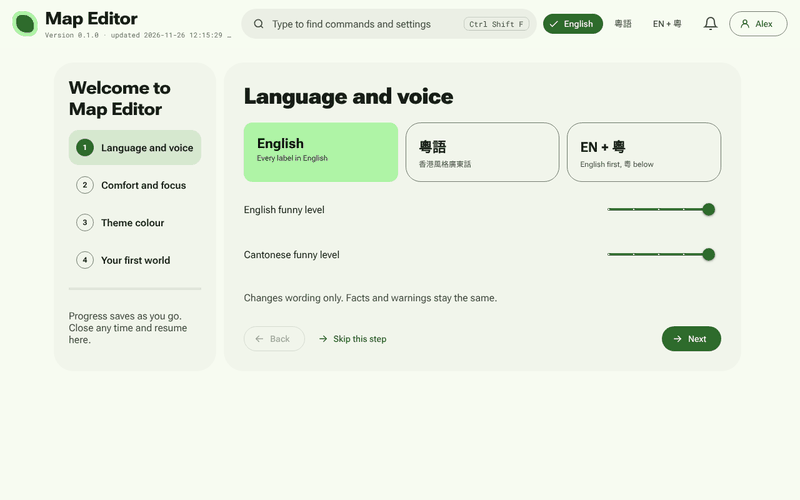
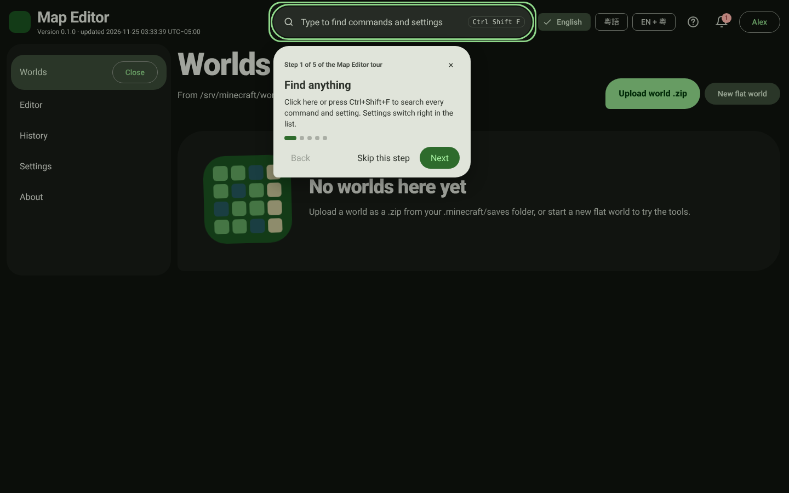
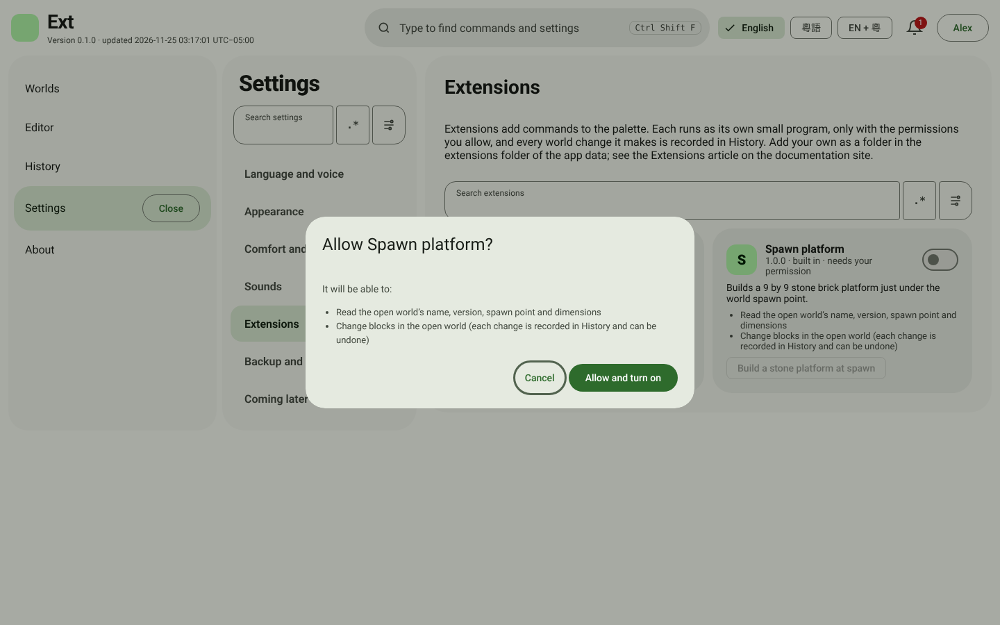

# Map Editor

**Documentation: https://ding-ding-projects.github.io/map-editor/**

The same guide is in this repository as plain Markdown, one page per feature: [docs/features](docs/features/README.md). It is also inside the app, offline, under **Guide**.

A Minecraft world editor for Java Edition and Bedrock Edition worlds, based on [Amulet Map Editor](https://github.com/Amulet-Team/Amulet-Map-Editor), rebuilt in TypeScript so the same editor runs three ways:

| Form | What you get |
| --- | --- |
| Desktop app | Windows installer (Squirrel, unsigned). Opens worlds from your `.minecraft/saves`. |
| Docker-hosted web app | `ghcr.io/ding-ding-projects/map-editor`, started with one command, used from any browser on your network. |
| Appliance OS image | A small Linux image that boots straight into the web app. Import the `.ova` into VirtualBox or VMware, or flash the `.img` to a USB drive for a spare PC. |

A separate **Map Editor Deploy** app does each of those in one click and gives you the working link.

**Every edit can be undone.** Each operation is saved and recorded in a private Git history kept in the app's own data folder (never inside your world). Rolling back adds a new history entry, so a rollback can be undone too.

**Contents:** [A look around](#a-look-around) · [Quick start](#quick-start) · [What it can do today](#what-it-can-do-today) · [Building everything](#building-everything) · [How long a person would have taken](#how-long-a-person-would-have-taken) · [Design](#design) · [Licence](#licence) · [Feature inventory](docs/features/INVENTORY.md) · [API in Postman](docs/postman/README.md) · [Contributing](CONTRIBUTING.md) · [Security](SECURITY.md)

## A look around

A one-minute walk through: sign in, make a water world, fill, measure, check History and Tools, then switch to the dark theme from the command palette.



New here? **Take a tour**: after setup the app offers a short guided tour that points at each real control. Start it again any time from the **?** Help menu, Settings › Comfort and focus, or the command palette (Ctrl+Shift+F). Every page has its own tour too, and so do the deploy app and the documentation site.



Extensions add commands in any language, each only with the permissions you allow:



## Quick start

**Windows, from source** (installs missing tools through Chocolatey, may show one admin prompt):

```bat
.\build.bat --run
```

**Docker web app** (asks for the port and your worlds folder, then prints the link):

```sh
node scripts/setup.mjs
```

On Windows, `host.bat` does the same, with `host.bat --detached` to run in the background or `host.bat --logs` to follow the live log. The first person to open the link becomes the owner; there is no setup code.

## What it can do today

Choose a part; each opens like a tab.

<details open><summary><b>Editing</b></summary>

- Open Java Edition 1.18+ worlds (Anvil regions, palette sections) in all three dimensions; upload a world as a .zip, download it again, or start a new flat world from six presets in four sizes.
- Open Bedrock Edition worlds too (1.2.13 and newer): the same map, side view, 3D view, Pick block, Fill, Replace, Delete blocks and Clone, using blocks already in the world. Saving adds one new file to the world database and never rewrites the others.
- Top-down map with a floating toolbar (Pan, Select, Pick block, Measure, Go to), zoom and Shift+drag selection, and a Side view panel that cuts vertically through the selection.
- Fill, replace, delete, clone and waterlog, ported from Amulet's stock operations, plus a Biome tool, with a 16.7 million block safety limit; a Blocks panel of colour swatches.
- Structure files (.nbt) in and out, with chest contents, sign text, mobs and item frames.
- Rich text notes per world (TinyMCE), saved automatically.

</details>

<details><summary><b>History and accounts</b></summary>

- Every edit in a private Git history: filters, search, per-edit change counts, roll back, Open as a copy, Undo and Ctrl+Z.
- An Activity panel for sign-ins, settings, extensions and worlds; passwords are never recorded.
- The first person to open it becomes the owner; passkeys as well as the password.

</details>

<details><summary><b>Workspace and comfort</b></summary>

- Editor, History and About built on dockview: panels you can dock, tab together, float and rearrange; on phones, panel chips above one group.
- Command palette on Ctrl+Shift+F with live setting switches and a jump to any setting; Find tabs with close by text; a regex builder beside every search.
- English, Hong Kong Cantonese and bilingual interface with funny-level sliders; Material 3 themes from any colour; reduced motion, large text, sounds, read aloud, locks, and a guided tour on every screen.
- A Tools tab with Base64, JSON to TypeScript and a coordinates helper.

</details>

<details><summary><b>Ways to run it</b></summary>

- A Windows desktop app that updates itself (unsigned Squirrel installers).
- A Docker web app, an appliance image for VirtualBox, VMware or a USB drive, and a Raspberry Pi 4 and 5 image; the appliance updates itself daily.
- Map Editor Deploy: one click to Docker (here or over SSH), VirtualBox, VMware or a drive, then manage, duplicate and follow the log.
- Extensions in any language, each only with the permissions you allow.

</details>

See [ROADMAP.md](ROADMAP.md) for what is verified, what is built but unverified, and what is still to do.

## Building everything

| Command | Output |
| --- | --- |
| `build.bat` / `./build.sh` | `dist/` bundles for the desktop app, server, web UI and deploy app |
| `build-installer.bat` | Unsigned Squirrel installers in `out/installers` with SHA-256 sums |
| `docker build .` | The web app image |
| `sudo appliance/build.sh <image.tar> <version>` | Appliance `.img`, `.vmdk` and `.ova` in `appliance/out` |
| `npm test` | Core, history and server tests |

The GitHub Actions workflow builds all of these on every push and publishes one release per build.

## How long a person would have taken

The tracked source, tests, scripts, site generator, appliance scripts and workflows come to about 16,700 lines, of which about 15,600 are not blank (counted with `node scripts/line-counts.mjs` on 2026-11-26, which leaves out the design export, generated pages and lock files; every release note carries the count made by the same script at that release). At an assumed 50 finished, tested lines a working day for one experienced developer, that is 13,300 / 50 = about 266 working days, a little over a year. It is an estimate from one assumed rate, not a measurement.

## Design

The interface is designed first on a design canvas; the source boards are in [`design/canvas`](design/canvas).

## Licence

Map Editor is based on Amulet Map Editor, which is proprietary software of the Amulet Team. Its licence is reproduced in [LICENSE](LICENSE); using Map Editor requires your own Amulet licence from https://www.amuletmc.com/. See [NOTICE.md](NOTICE.md) for this and the third-party licences. Minecraft is a trademark of Mojang Synergies AB; this project is not affiliated with Mojang or Microsoft.
