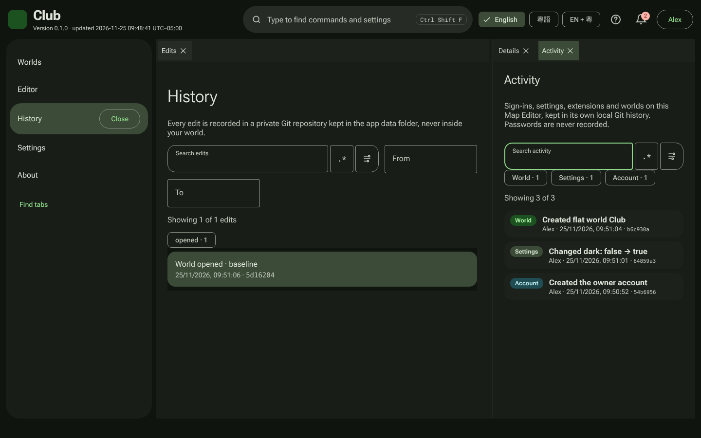
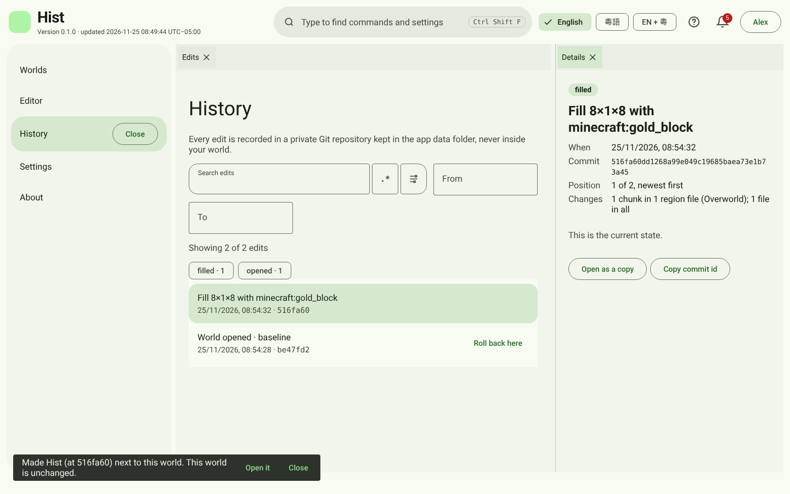

# Edit history · 編輯歷史

> Every edit is saved to a private Git history so it can always be undone.
>
> 每一次編輯都會儲存喺一個私人嘅 Git 歷史度，所以永遠都復原得返。

Category: [Using the editor](README.md) · [Read on the website, with pictures](https://ding-ding-projects.github.io/map-editor/edit-history/)

## Edits and details

The History tab has two panels you can move, tab together or float like the editor's: Edits lists every change, and Details shows the one you pick, with its time, full commit id and position, Roll back here and Copy commit id. Settings › Appearance › Reset panel layouts puts every screen's panels back.

「歷史（History）」分頁有兩個面板，可以好似編輯器嗰啲噉搬位、疊埋做分頁或者浮起：「編輯（Edits）」會列出每一項改動，「詳情（Details）」就顯示你揀嗰一項，連埋佢嘅時間、完整嘅提交編號同位置，仲有「還原到呢度（Roll back here）」同「複製提交編號（Copy commit id）」。「設定（Settings）› 外觀（Appearance）› 重設面板版面（Reset panel layouts）」會將每個畫面嘅面板放返原位。

## Finding an edit

The History tab has a search box for the edit description or commit, From and To dates, and a chip per kind of edit with its count. They combine, and the line above the list says how many edits are shown.

「歷史（History）」分頁有一個搜尋框，用嚟搵編輯嘅描述或者提交；有「由（From）」同「到（To）」兩個日期；每種編輯仲有一個連埋數量嘅小標籤。呢幾樣可以夾埋一齊用，而清單上面嗰行字會講明顯示緊幾多項編輯。

## How it works

After each operation the changed region files are saved and committed to a Git repository kept in the app data folder. The repository is never created inside your world folder, and a world that already has its own .git is left alone.

每次操作之後，改咗嘅區域檔案會儲存低，再提交去一個放喺程式資料夾入面嘅 Git 儲存庫。個儲存庫永遠唔會喺你個世界資料夾入面建立，而一個本身已經有自己 .git 嘅世界，佢唔會掂。

## Rolling back

Choose Roll back here on any entry. The world files are restored from that point and the restore is recorded as a new entry, so you can undo a rollback too. Nothing in the history is ever rewritten.

喺任何一個項目度揀「還原到呢度（Roll back here）」。世界檔案會由嗰個時間點還原返，而今次還原會記錄做一個新項目，所以連還原都復原得返。歷史入面嘅嘢永遠唔會被改寫。

## Activity record

Besides world edits, Map Editor keeps an activity record: the owner account being created, sign-ins (and failed ones), sign-outs, settings changes, extensions being installed, allowed, switched off or removed, and worlds being created, uploaded or copied. Each is one entry in its own local Git history in the data folder, and passwords are never recorded. History shows it in the Activity panel, with a search box and a chip per kind; it is there even before a world is open. Map Editor Deploy keeps the same kind of record for its deploys, duplicates, drive writes and instance actions, under Instances.

除咗世界編輯之外，Map Editor 仲會保存一份活動記錄：建立擁有人帳戶、登入（同埋登入失敗）、登出、設定改動、擴充功能被安裝、容許、閂咗或者移除，同埋世界被建立、上載或者複製。每一項都係資料夾入面佢自己嗰個本機 Git 歷史裏面嘅一個項目，而密碼永遠唔會被記錄。「歷史（History）」會喺「活動（Activity）」面板度顯示佢，有一個搜尋框同每種一個小標籤；就算未開任何世界，佢都喺度。Map Editor Deploy 都會為佢嘅部署、複製執行個體、磁碟寫入同執行個體動作保存同類嘅記錄，放喺「執行個體（Instances）」下面。

## Opening an earlier version as a copy

Open as a copy, in Details, writes the world as it was at that entry into a new folder next to it, named after the world and the short commit id (for example Survival at 1b89e32), and renames the copy inside the game so the two are easy to tell apart. The world you are editing and its history are not touched. A notification offers Open it. Details also counts what each entry changed: chunks, region files and which dimensions, plus the number of files.

「詳情（Details）」入面嘅「開做副本（Open as a copy）」，會將個世界喺嗰個項目嗰陣嘅樣，寫入佢隔籬一個新資料夾，個名由世界名同短提交編號組成（例如 Survival at 1b89e32），仲會喺遊戲入面幫個副本改名，等兩個容易分得開。你編輯緊嗰個世界同佢嘅歷史都唔會被掂到。會有個通知畀你揀「開啟佢（Open it）」。「詳情」仲會數埋每個項目改咗啲乜：區塊、區域檔案同埋邊啲維度，再加埋檔案數目。

## Filtering

Action chips show how many entries of each kind exist and filter the list.

動作小標籤會顯示每一種有幾多個項目，仲可以用嚟篩選個清單。

## Related

- [Editing worlds](../using-the-editor/editing.md)
- [World notes](../using-the-editor/notes.md)
- [What is next](../project/roadmap.md)

<!-- Generated by scripts/feature-docs.mjs from site/content.mjs. Edit the source, then run the script. -->
