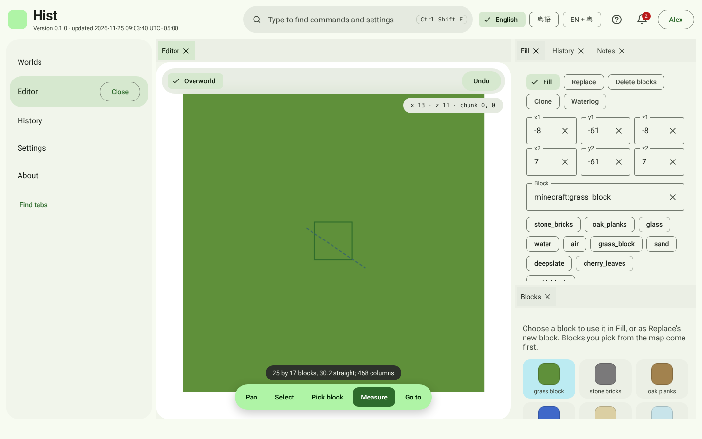
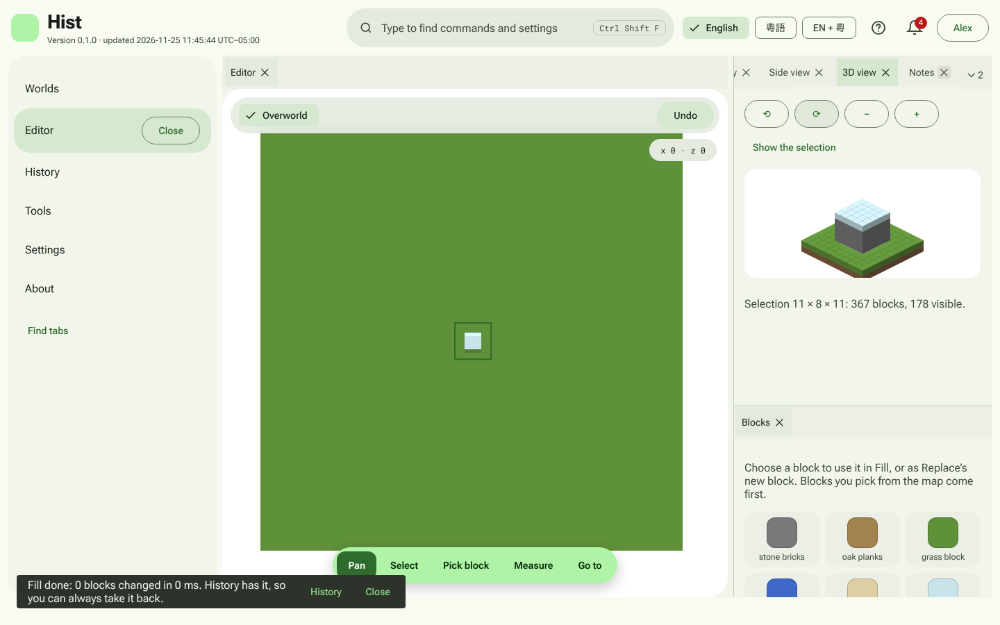
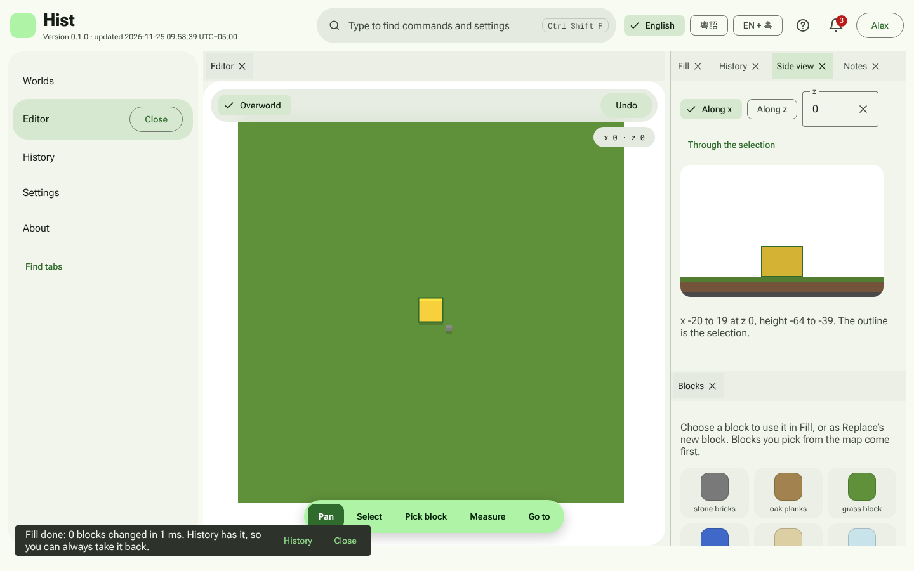
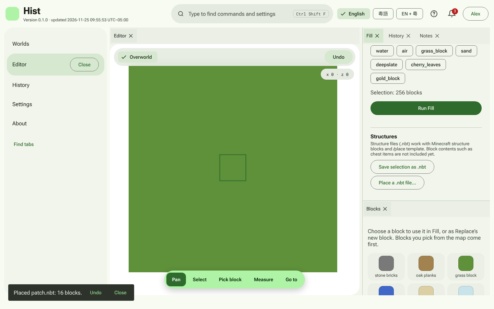

# Editing worlds · 編輯世界

> Top-down map, selections, and the fill, replace, delete, clone and waterlog tools.
>
> 俯視地圖、選取範圍，同埋填充、取代、刪除、複製同注水呢幾樣工具。

Category: [Using the editor](README.md) · [Read on the website, with pictures](https://ding-ding-projects.github.io/map-editor/editing/)

## The map

The Map panel shows each column from above, shaded by height. Drag to pan, scroll to zoom, and hold Shift while dragging to draw a selection. The coordinates under the pointer are shown in the corner.

「地圖（Map）」面板會由上面望落去顯示每一條直柱，按高度加深淺。拖就可以平移，捲動就可以縮放，撳住 Shift 再拖就可以畫一個選取範圍。指標下面嘅座標會喺個角度顯示。

## Right-click menu

Right-click the map (or press the Menu key or Shift+F10 while the map has focus; long-press on a touch screen) for a menu at that block: copy its coordinates, use the block there, set the first or second selection corner, centre the map, go to a coordinate, switch tool, or undo. The menu has its own search field with the regex builder, and every dropdown in the app opens the same kind of searchable menu.

喺地圖度撳右鍵（或者地圖有焦點嗰陣撳 Menu 鍵或者 Shift+F10；觸控螢幕就長按），就會喺嗰個方塊度開一個選單：複製佢嘅座標、用嗰度嗰個方塊、設定第一個或者第二個選取角、將地圖置中、去某個座標、轉工具，或者復原。個選單有自己嘅搜尋欄，連埋正規表示式建立器，而個程式入面每一個下拉選單，開出嚟都係同一種可以搜尋嘅選單。

## Map toolbar

The toolbar floating over the map sets what a drag or click does: Pan (H) moves the map, Select (S) draws the selection, Pick block (I) uses the block on top of the column you click in Fill (or as Replace’s new block), Measure (M) shows the distance between two points and the area between them, and Go to (G) centres the map on an x and z you type or click. Shift+drag always selects. The line above the toolbar says what happened.

浮喺地圖上面嗰條工具列，決定拖或者撳一下會做啲乜：平移（Pan，H）會郁個地圖；選取（Select，S）會畫選取範圍；揀方塊（Pick block，I）會將你撳嗰條直柱最頂嗰個方塊攞去填充（Fill）度用（或者做取代（Replace）嘅新方塊）；量度（Measure，M）會顯示兩點之間嘅距離同埋佢哋之間嘅面積；前往（Go to，G）會將地圖置中喺你打或者撳嘅 x 同 z 度。Shift 加拖永遠都係選取。工具列上面嗰行字會講畀你知啱啱發生咗乜事。

## 3D view

The 3D view panel draws the selection as shaded cubes seen from above at an angle. Turn it a quarter at a time with the arrows and zoom with + and −; Show the selection redraws it after you change the selection, and it redraws by itself after every edit. It shows up to 64 blocks in each direction.

「3D 視圖（3D view）」面板會將選取範圍畫成有深淺嘅立方體，由上面斜斜哋望落去。用箭嘴每次轉四分之一圈，用 + 同 − 縮放；你改咗選取範圍之後，「顯示選取範圍（Show the selection）」會重新畫過，而每次編輯之後佢都會自己重新畫。佢每個方向最多顯示 64 個方塊。

## Side view

The Side view panel shows a vertical cut through the world: Along x shows the blocks from west to east at one z, Along z from north to south at one x. It cuts through the middle of the selection, which is outlined, and covers a little more than the selection on each side; type another position or choose Through the selection to go back. It updates after every edit.

「側面圖（Side view）」面板會顯示一個垂直切開個世界嘅切面：「沿 x（Along x）」顯示某一個 z 上面由西到東嘅方塊，「沿 z（Along z）」就顯示某一個 x 上面由北到南嘅。佢會切過選取範圍嘅中間，選取範圍會有外框，而每一邊都會比選取範圍闊少少；可以打另一個位置，或者揀「穿過選取範圍（Through the selection）」返去。每次編輯之後佢都會更新。

## Structures

Under the tools, Save selection as .nbt downloads the selected blocks as a structure file, the format Minecraft uses for structure blocks and /place template, air included so placing it clears what was there. Place a .nbt file… asks for a file and places it with its corner at the selection’s lowest corner after you confirm; it is recorded in History as Placed, so Undo takes it back. Chest contents, sign text and other block data travel with their blocks, and mobs, item frames and armour stands inside the box travel too (placed copies get new identities so they never clash with the originals). Blocks that land in chunks that do not exist are skipped.

喺啲工具下面，「將選取範圍儲存做 .nbt（Save selection as .nbt）」會將揀咗嘅方塊下載做一個結構檔案，即係 Minecraft 用喺結構方塊同 /place template 嘅格式，連空氣都包埋，所以放落去嗰陣會清走原本喺嗰度嘅嘢。「放置一個 .nbt 檔案…（Place a .nbt file…）」會問你要個檔案，等你確認之後，將佢個角放喺選取範圍最低嗰個角度；佢會喺「歷史（History）」度記錄做「已放置（Placed）」，所以「復原（Undo）」收得返。箱入面嘅嘢、告示牌嘅字同其他方塊資料會跟住啲方塊一齊去，而個框入面嘅生物、物品展示框同盔甲座都會一齊去（放落去嘅副本會有新嘅身份，所以永遠唔會同原本嗰啲相撞）。落喺唔存在嘅區塊度嘅方塊會被跳過。

## Block palette

The Blocks panel shows colour swatches for common blocks; choose one to use it in Fill, or as the new block in Replace. Blocks you pick from the map come first.

「方塊（Blocks）」面板會顯示常用方塊嘅色板；揀一個就可以喺填充（Fill）度用，或者做取代（Replace）嘅新方塊。你喺地圖度揀嘅方塊會排最先。

## Tools

Fill sets every block in the selection. Replace swaps one block for another. Delete blocks sets air. Clone copies the selection to a destination corner and is safe when source and destination overlap. Waterlog sets waterlogged on blocks that support it. Biome (B) sets the biome over the selection; the game stores biomes per 4×4×4 cell, so the edges round out to whole cells.

填充（Fill）會設定選取範圍入面每一個方塊。取代（Replace）會將一種方塊換做另一種。刪除方塊（Delete blocks）會設定做空氣。複製（Clone）會將選取範圍抄去一個目的地角，就算來源同目的地重疊都安全。注水（Waterlog）會喺支援嘅方塊上面設定含水。生態域（Biome，B）會設定成個選取範圍嘅生態域；遊戲係以每 4×4×4 一格嚟儲存生態域，所以邊緣會湊夠成格。

## Limits

One operation can change up to 16,777,216 blocks so a typo cannot hang the editor. Blocks in chunks that do not exist yet are skipped and reported, never invented.

一次操作最多可以改 16,777,216 個方塊，噉樣打錯字都唔會令個編輯器卡死。喺仲未存在嘅區塊入面嘅方塊會被跳過兼報告出嚟，永遠唔會憑空整出嚟。

## Dimensions and undo

Chips at the top of the map switch between the dimensions the world has. Undo, or Ctrl+Z, rolls back the last edit.

地圖最頂嘅小標籤可以喺個世界有嘅維度之間切換。「復原（Undo）」或者 Ctrl+Z 會將上一次編輯還原。

## Workspace

The editor is a dockview workspace: drag a panel tab to dock it beside another, tab panels together or float one. The layout is remembered in your browser.

個編輯器係一個 dockview 工作區：拖一個面板嘅分頁，就可以將佢泊喺另一個隔籬、將幾個面板疊埋做分頁，或者令其中一個浮起。版面配置會記喺你個瀏覽器度。

## Related

- [Edit history](../using-the-editor/edit-history.md)
- [World notes](../using-the-editor/notes.md)
- [Theme colours and the colour picker](../settings/appearance.md)

<!-- Generated by scripts/feature-docs.mjs from site/content.mjs. Edit the source, then run the script. -->
