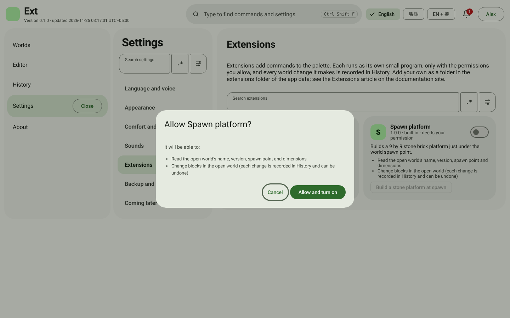

# Extensions: using and writing them · 擴充功能：點用同點寫

> Add commands with small programs in any language, each limited to the permissions you allow.
>
> 用任何語言寫嘅細程式嚟加指令，每個都只限於你容許嘅權限。

Category: [Using the editor](README.md) · [Read on the website, with pictures](https://ding-ding-projects.github.io/map-editor/extensions/)

## Using extensions

Settings › Extensions lists every extension with its version, what it may do and its commands. Switching one on shows exactly which permissions it asks for; it only turns on if you allow them. Its commands then appear in the command palette (Ctrl+Shift+F). If a new version asks for different permissions, it is switched off until you allow the new set. Map Editor ships two: Selection report (reads the world and selection) and Spawn platform (builds a 9 by 9 platform under spawn).

「設定（Settings）› 擴充功能（Extensions）」會列出每一個擴充功能，連埋版本、佢可以做啲乜同埋佢嘅指令。開啟一個嗰陣，會清楚顯示佢要求邊啲權限；你容許咗佢先至會開。之後佢嘅指令就會喺指令面板（Ctrl+Shift+F）度出現。如果新版本要求嘅權限唔同咗，佢會被閂咗，直到你容許新嗰組權限為止。Map Editor 本身附帶兩個：選取範圍報告（Selection report）（讀取世界同選取範圍）同重生平台（Spawn platform）（喺重生點下面起一個 9 乘 9 嘅平台）。

## Where extensions live

Each extension is a folder inside the extensions folder of Map Editor's data folder: in the desktop app that is the app data folder, in Docker it is the /data volume. The folder holds manifest.json and the program. Built-in extensions cannot be replaced by a folder with the same id.

每個擴充功能都係 Map Editor 資料夾入面 extensions 資料夾裏面嘅一個資料夾：喺桌面程式度，嗰個係程式資料夾；喺 Docker 度，就係 /data 儲存區。個資料夾入面有 manifest.json 同埋個程式。內置嘅擴充功能，唔可以用一個 id 相同嘅資料夾嚟取代。

## Adding, removing and switching off

Add from .zip… installs an extension packed as a .zip (manifest.json at the top or one folder down, up to 20 MiB). Add from link… downloads such a .zip from an https link; links that name this computer or a private network address are refused. If the author publishes a SHA-256 for the .zip, paste it in the SHA-256 field: a download that differs is refused and nothing is installed. Either way, the notification shows the SHA-256 of what was installed. The desktop app can also Add from folder… and Open extensions folder. If that extension is already installed, Map Editor asks before replacing it, and a new version stays off until you allow it again. Extensions you added have Remove; built-in ones can only be switched off. The Extensions switch at the top turns every extension off at once, and Recent runs lists the last runs with their time, duration and result.

「由 .zip 加入…（Add from .zip…）」會安裝一個包成 .zip 嘅擴充功能（manifest.json 喺最頂層或者落一層資料夾，最大 20 MiB）。「由連結加入…（Add from link…）」會由一條 https 連結下載呢種 .zip；如果條連結指住呢部電腦或者私人網絡地址，就會被拒絕。如果作者有公佈個 .zip 嘅 SHA-256，就將佢貼入 SHA-256 欄位：下載返嚟嘅嘢如果唔同，就會被拒絕，乜都唔會裝。無論邊種方法，通知都會顯示裝咗嗰樣嘢嘅 SHA-256。桌面程式仲可以「由資料夾加入…（Add from folder…）」同「開啟擴充功能資料夾（Open extensions folder）」。如果嗰個擴充功能已經裝咗，Map Editor 會問咗你先至取代佢，而新版本會保持閂住，直到你再容許佢為止。你自己加嘅擴充功能有「移除（Remove）」；內置嗰啲就只可以閂咗佢。最頂嗰個「擴充功能（Extensions）」開關可以一次過閂晒所有擴充功能，而「最近執行（Recent runs）」會列出最近幾次執行，連埋時間、用咗幾耐同結果。

## manifest.json

manifestVersion is 1. id is 2 to 41 lower-case letters, digits or dashes. name, version (like 1.0.0) and an optional description describe it. run is the program and its arguments, started inside the folder; the word node means the Node.js that runs Map Editor, so JavaScript extensions need nothing installed. permissions is any of world-info, selection and edit-world. commands lists up to 20 commands, each with an id and a title.

manifestVersion 係 1。id 係 2 到 41 個細楷字母、數字或者連字號。name、version（好似 1.0.0 噉）同一個可有可無嘅 description 用嚟形容佢。run 係個程式同佢嘅參數，會喺個資料夾入面啟動；node 呢個字指嘅係行緊 Map Editor 嗰個 Node.js，所以 JavaScript 擴充功能乜都唔使裝。permissions 可以係 world-info、selection 同 edit-world 當中任何幾個。commands 最多列 20 個指令，每個都有一個 id 同一個 title。

## Request and answer

Map Editor starts the program, writes one line of JSON to its standard input and reads one line of JSON from its standard output. The request has type run, protocol 1, the command id, world (name, version, dataVersion, spawn, dimensions) when it has world-info, selection (dimension and box with x1, y1, z1, x2, y2, z2) when it has selection, and limits. The answer must have type result and may have a message to show. With edit-world it may also have ops, up to 64 operations shaped like the editor's own: op is fill, replace, delete, clone or waterlog, with dimension, box, and block, from and to, or dest as the operation needs. Each operation is applied as a normal edit, so it appears in History and can be undone.

Map Editor 會啟動個程式，將一行 JSON 寫入佢嘅標準輸入，再由佢嘅標準輸出讀一行 JSON。個請求有 type run、protocol 1、指令嘅 id；有 world-info 權限嗰陣有 world（name、version、dataVersion、spawn、dimensions）；有 selection 權限嗰陣有 selection（dimension，同埋有 x1、y1、z1、x2、y2、z2 嘅 box）；仲有 limits。個回覆一定要有 type result，亦可以有一個用嚟顯示嘅 message。有 edit-world 嘅話，佢仲可以有 ops，最多 64 個操作，形狀同編輯器自己嗰啲一樣：op 係 fill、replace、delete、clone 或者 waterlog，按個操作嘅需要配上 dimension、box，同埋 block、from 同 to，或者 dest。每個操作都會當成一次普通編輯嚟套用，所以會喺「歷史（History）」度出現，亦都復原得返。

## Limits and safety

An extension that has not answered after 10 seconds, or sends more than 1 MiB, is stopped and nothing changes. It runs with an empty environment apart from PATH, so it never receives passwords, session cookies, tokens or file paths from Map Editor. Operations it proposes are checked the same way as the editor's, and any answer that asks for edits without edit-world is refused as a whole.

一個擴充功能如果過咗 10 秒都未回覆，或者送出多過 1 MiB，就會被停止，乜都唔會變。佢行嗰陣，除咗 PATH 之外個環境係空嘅，所以佢永遠唔會由 Map Editor 度收到密碼、工作階段 cookie、權杖或者檔案路徑。佢提出嘅操作，會用同編輯器一樣嘅方法檢查；而任何冇 edit-world 權限但係要求編輯嘅回覆，會成個被拒絕。

## Runnable samples

The samples/extensions folder in the source repository has hello-node (JavaScript, reads the world name) and hello-python (Python 3, says hello and can lay a glass floor under the selection). Copy one into the extensions folder, open Settings › Extensions and switch it on. Both are run by the automated tests, so they stay working.

原始碼儲存庫入面嘅 samples/extensions 資料夾有 hello-node（JavaScript，讀取世界個名）同 hello-python（Python 3，會打聲招呼，仲可以喺選取範圍下面鋪一層玻璃地板）。抄其中一個入 extensions 資料夾，開「設定（Settings）› 擴充功能（Extensions）」再開啟佢。兩個都會由自動測試行一次，所以會一直用得。

## Related

- [Command palette and shortcuts](../using-the-editor/shortcuts.md)
- [Edit history](../using-the-editor/edit-history.md)
- [Editing worlds](../using-the-editor/editing.md)

<!-- Generated by scripts/feature-docs.mjs from site/content.mjs. Edit the source, then run the script. -->
