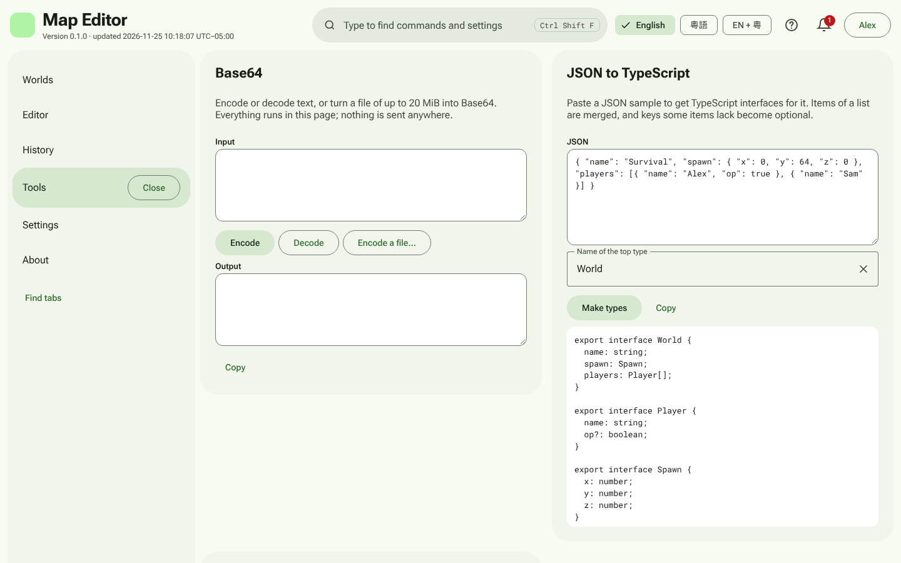
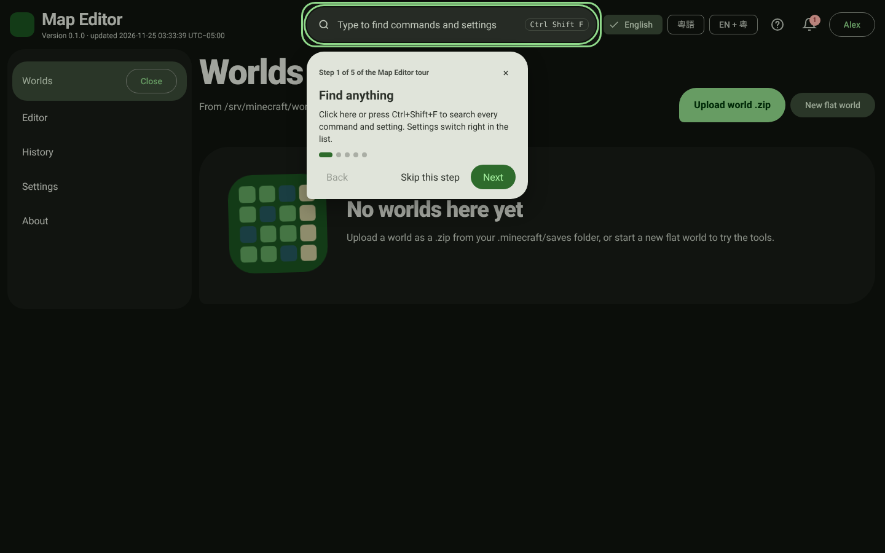
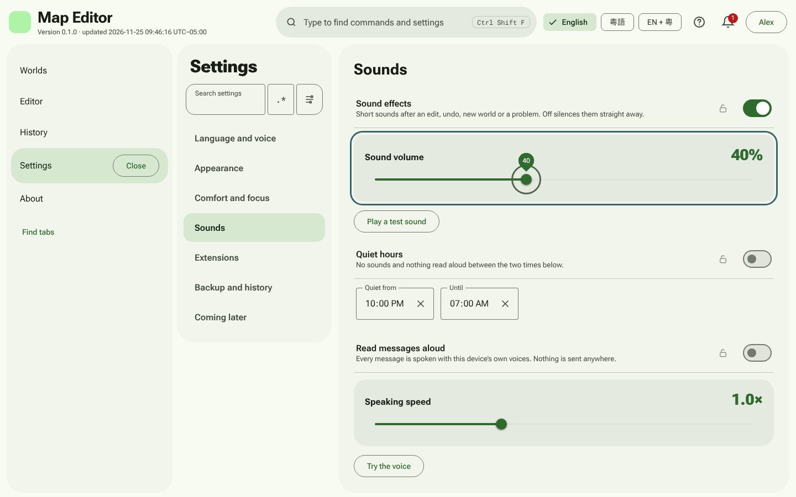
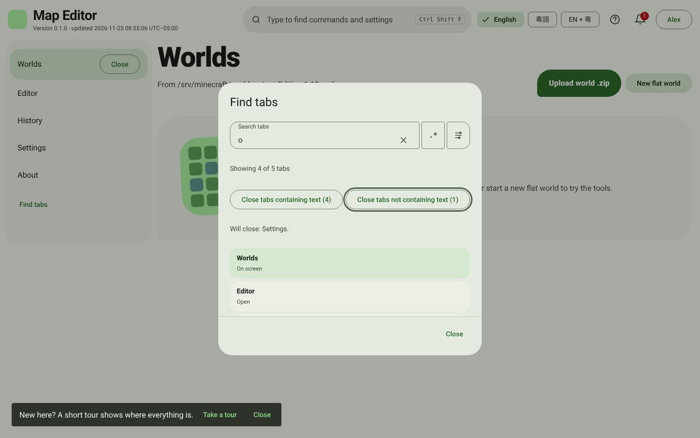

# Command palette and shortcuts · 指令面板同快捷鍵

> Ctrl+Shift+F finds every command and setting; settings switch right in the list.
>
> Ctrl+Shift+F 搵到每一個指令同設定；設定可以直接喺個清單度切換。

Category: [Using the editor](README.md) · [Read on the website, with pictures](https://ding-ding-projects.github.io/map-editor/shortcuts/)

## Focus and school modes

Settings › Comfort and focus has Focus mode: routine messages wait quietly in the bell (problems still pop up), dim sum surprises stop, motion is reduced, buttons get larger and the panel you are working in stands out. School mode, for a classroom computer, switches every extension off, hides adding new ones, turns off the full-screen result cards and locks the Settings screen; it asks first.

「設定（Settings）› 舒適同專注（Comfort and focus）」有專注模式（Focus mode）：日常訊息會靜靜哋喺個鈴鐺度等（有問題嘅話照樣會彈出嚟），點心驚喜會停，動態效果會減少，按鈕會大啲，而你做緊嘢嗰個面板會突出啲。學校模式（School mode）係畀課室電腦用嘅，佢會閂晒所有擴充功能、收埋加新擴充功能嘅地方、閂咗全螢幕結果卡片，仲會鎖住設定畫面；佢會問咗你先。

## Tools

The Tools tab has small helpers that work entirely in the page: Base64 for text or a file of up to 20 MiB, JSON to TypeScript (paste a sample, get interfaces; items of a list are merged and keys some items lack become optional), Coordinates (the chunk, the place inside it, the region file and the matching Nether or Overworld position of any x and z), a file converter (pictures to PNG, JPEG or WebP; Minecraft NBT files to JSON), Server settings (open a server.properties file, change the common settings, save it) and a Local AI helper that asks a model in Ollama on the computer running Map Editor; set MAP_EDITOR_OLLAMA if Ollama is somewhere else.

「工具（Tools）」分頁有啲細細哋嘅幫手，全部都係喺頁面入面完成：Base64，處理文字或者最大 20 MiB 嘅檔案；JSON 轉 TypeScript（貼一個樣本入去就攞到介面；清單入面嘅項目會合併，有啲項目冇嘅鍵會變成可選）；座標（Coordinates）（任何 x 同 z 所屬嘅區塊、喺區塊入面嘅位置、區域檔案，同埋對應嘅地獄或者主世界位置）；檔案轉換器（圖片轉做 PNG、JPEG 或者 WebP；Minecraft NBT 檔案轉做 JSON）；伺服器設定（Server settings）（開一個 server.properties 檔案，改常用嘅設定，再儲存）；仲有一個本機 AI 幫手（Local AI helper），佢會問行緊 Map Editor 嗰部電腦上面 Ollama 入面嘅模型；如果 Ollama 喺第二度，就設定 MAP_EDITOR_OLLAMA。

## Take a tour

A guided tour points at each real control with a ring and a small card: Step N of M, Back, Skip this step and Next, with Esc to close and the arrow keys to move. It is offered once after setup and can be started again from the ? Help menu, Settings › Comfort and focus, or the palette; Tour this page explains only the page you are on, and the tour picks up where you left it. Steps whose control is not on screen say so and offer to show it. This site has a tour too: Take a tour at the top of every page.

導覽會用一個圈同一張細卡片，逐個指住真正嘅控制項：「第 N 步，共 M 步（Step N of M）」、「返回（Back）」、「跳過呢步（Skip this step）」同「下一步（Next）」，撳 Esc 就閂，用方向鍵就可以移動。設定完之後佢會問你一次要唔要睇，之後可以喺「? 說明（Help）」選單、「設定（Settings）› 舒適同專注（Comfort and focus）」或者指令面板度再開過；「遊覽呢一頁（Tour this page）」淨係解釋你而家身處嗰一頁，而個導覽會由你上次停低嘅地方繼續。如果某一步嘅控制項唔喺畫面上面，佢會講畀你知，仲會提議顯示佢出嚟。呢個網站都有導覽：每一頁最頂都有「遊覽一次（Take a tour）」。

## Regular expressions in every search

Every search box matches plain text, ignoring case, until you press the .* button next to it; that turns regular expressions on for that box only, and your text stays as typed. The button beside it opens the builder: a pattern editor that stays in step with the box, buttons that insert common pieces, a box that adds text escaped so it matches exactly, the i, m, s and u flags, and sample text with every match highlighted and its capture groups listed. Patterns use the JavaScript (ECMAScript) engine, run on your device in a separate worker and are stopped after 250 ms, so a pattern that would take forever cannot freeze the app. Patterns are limited to 512 characters and sample text to 10,000. Nothing you type there is saved or sent anywhere. The builder also has ready-made patterns: Starts with Fill or Replace, Sizes, Commit ids, Block names and Dates; choose one to load it, then adjust it.

每個搜尋框都係配對普通文字，唔分大細楷，直到你撳佢隔籬個 .* 按鈕為止；撳咗就只會喺嗰一個框度開啟正規表示式，而你打嘅字會原封不動。再隔籬嗰個按鈕會開啟建立器：一個同個搜尋框保持同步嘅樣式編輯器、用嚟插入常用部件嘅按鈕、一個會幫你加入已經轉義咗嘅文字等佢可以完全照字配對嘅框、i、m、s 同 u 旗標，同埋一段示範文字，每個配對都會標示出嚟，仲會列出佢嘅擷取群組。樣式用嘅係 JavaScript（ECMAScript）引擎，喺你部裝置上面一個獨立嘅 worker 度行，過咗 250 ms 就會被停止，所以一個要行到天荒地老嘅樣式都凍結唔到個程式。樣式最多 512 個字元，示範文字最多 10,000 個。你喺嗰度打嘅嘢唔會儲存，亦唔會傳去任何地方。建立器仲有啲現成嘅樣式：以 Fill 或者 Replace 開頭（Starts with Fill or Replace）、大細（Sizes）、提交編號（Commit ids）、方塊名（Block names）同日期（Dates）；揀一個載入，然後再慢慢調。

## Command palette

Press Ctrl+Shift+F or select the search bar at the top. Type to filter; arrow keys move, Enter runs, Esc closes. Settings such as Dark theme and Reduce motion appear as switches in the list, so you can change them without leaving the palette. Every setting has a row: Shift+Enter, or the arrow at the end of the row, opens Settings at that exact control, focuses it and flashes a ring round it. Drag the palette’s corner to resize it; it opens at that size next time.

撳 Ctrl+Shift+F，或者揀最頂嗰條搜尋列。打字就可以篩選；方向鍵用嚟移動，Enter 執行，Esc 閂咗佢。好似「深色主題（Dark theme）」同「減少動態效果（Reduce motion）」呢類設定，會喺清單度以開關嘅樣出現，所以你唔使離開個面板都改到。每個設定都有一行：撳 Shift+Enter，或者嗰行最尾嘅箭嘴，就會開啟設定去到嗰個控制項嘅確實位置，將焦點放喺佢度，再喺佢周圍閃一個圈。拖個面板嘅角就可以改大細；下次開嗰陣會用返嗰個大細。

## Shortcuts

In the editor, F, R, D, C and W pick Fill, Replace, Delete blocks, Clone and Waterlog. Ctrl+Z undoes the last edit by adding a restore entry to the history, so the undo itself can be undone.

喺編輯器入面，F、R、D、C 同 W 分別揀填充（Fill）、取代（Replace）、刪除方塊（Delete blocks）、複製（Clone）同注水（Waterlog）。Ctrl+Z 會復原上一次編輯，做法係喺歷史度加一個還原項目，所以連個復原本身都復原得返。

## Finding and closing tabs

Find tabs, under the tab list or in the command palette, searches every tab, open or closed; choose one to go there or reopen it. Type some text and use Close tabs containing text or Close tabs not containing text: each button shows how many tabs it would close, and focusing it lists them first. An empty or broken search closes nothing, one tab always stays open, and the editor stays open while an edit is running. Open every tab brings closed tabs back.

「搵分頁（Find tabs）」喺分頁清單下面或者指令面板度都有，佢會搜尋每一個分頁，開住嘅同閂咗嘅都搵；揀一個就可以去嗰度或者重新開返佢。打啲字，再用「閂晒包含呢段字嘅分頁（Close tabs containing text）」或者「閂晒唔包含呢段字嘅分頁（Close tabs not containing text）」：每個按鈕都會顯示佢會閂幾多個分頁，將焦點放上去仲會先列出係邊啲。空白或者壞咗嘅搜尋乜都唔會閂，永遠會有一個分頁留低開住，而有編輯行緊嗰陣編輯器會保持開住。「開晒所有分頁（Open every tab）」會將閂咗嘅分頁帶返嚟。

## Notifications

The bell keeps every message from this session with its time. Dismiss all clears them.

個鈴鐺會保留今個工作階段嘅每一個訊息，連埋時間。「全部清除（Dismiss all）」會清走晒。

## About and changelog

The About tab shows the version and build, the licence note, and Copy version details for bug reports. Its changelog lists every change in this build, newest first, marked Added, Fixed or Changed, with a search box.

「關於（About）」分頁會顯示版本同建置編號、授權說明，仲有「複製版本詳情（Copy version details）」方便報告問題。佢嘅更新記錄會列出今個建置入面每一項改動，最新嘅排最先，標明係「新增（Added）」、「修正（Fixed）」定「更改（Changed）」，仲有個搜尋框。

## Related

- [Editing worlds](../using-the-editor/editing.md)
- [Edit history](../using-the-editor/edit-history.md)
- [Theme colours and the colour picker](../settings/appearance.md)

<!-- Generated by scripts/feature-docs.mjs from site/content.mjs. Edit the source, then run the script. -->
