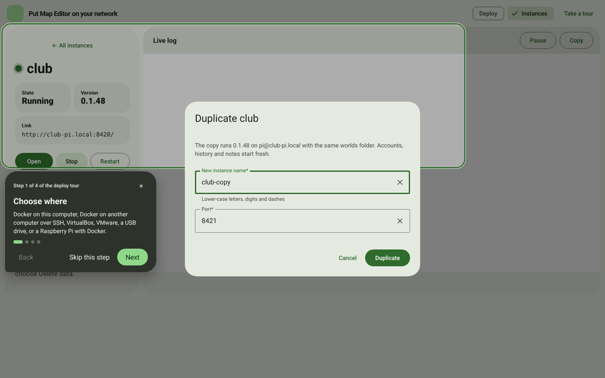

# Map Editor Deploy

> One click to put Map Editor on Docker, VirtualBox or a USB drive, then the working link.
>
> 撳一下就將 Map Editor 放上 Docker、VirtualBox 或者 USB 手指，然後畀返條用得嘅連結你。

Category: [Ways to run it](README.md) · [Read on the website, with pictures](https://ding-ding-projects.github.io/map-editor/deploy-app/)

## Targets

Docker on this computer pulls the published image, starts it with Compose and waits for the health check. Docker on another computer does the same on a server, NAS or Raspberry Pi 4 or 5 through SSH: enter user@host and the worlds folder on that computer. It uses your own SSH key (the login must work without a password prompt) and stores no passwords. VirtualBox imports the appliance with a bridged adapter, starts it headless and reads its network address. USB drive writes the appliance image to a removable drive.

「呢部電腦嘅 Docker（Docker on this computer）」會拉已發佈嘅映像落嚟，用 Compose 啟動，再等健康檢查通過。「另一部電腦嘅 Docker（Docker on another computer）」就經 SSH 喺伺服器、NAS 或者 Raspberry Pi 4 或 5 上面做同一樣嘢：輸入 user@host 同嗰部電腦上面嘅世界資料夾。佢用你自己條 SSH 密鑰（登入一定要唔使問密碼先得），唔會儲存任何密碼。VirtualBox 會用橋接介面卡匯入個設備，用無視窗模式啟動，再讀出佢嘅網絡地址。「USB 手指（USB drive）」會將設備映像寫入一個抽取式磁碟。

## Flashing safely

Only removable drives are listed, the drive running your system is never offered, and nothing is selected for you. You type a confirmation that names the drive. After writing, the drive is read back and its SHA-256 compared with the image before success is shown.

淨係會列出抽取式磁碟，行緊你個系統嗰個磁碟永遠唔會畀你揀，亦都唔會幫你預先揀定任何嘢。你要打一句寫明磁碟名嘅確認。寫完之後，個磁碟會讀返出嚟，將佢嘅 SHA-256 同個映像對過，先至會顯示成功。

## When it finishes

A full-screen card says It is live with the link, version and how long it took, and closes by itself after 8 seconds unless you are using it. If something fails, a red card stays until you dismiss it and shows each step, the exact error, Copy details and a retry; when the port is already taken it offers the next port.

會有張全螢幕卡片話「已經上線（It is live）」，連埋條連結、版本同用咗幾耐，8 秒之後自己閂，除非你用緊佢。如果有嘢失敗，會有張紅色卡片留喺度，直到你閂咗佢為止，上面顯示每一步、確實嘅錯誤、「複製詳情（Copy details）」同重試；如果個連接埠已經畀人用咗，佢會提議用下一個連接埠。

## Instances

The Instances view lists only what this app created, with its current state and the verified link for each.

「執行個體（Instances）」檢視只會列出呢個程式自己建立嘅嘢，連埋每個而家嘅狀態同已經驗證過嘅連結。

## Managing an instance

Manage opens one instance: a state dot, its version and link, and buttons for Open, Start or Stop, Restart and Update (pulls the newest image and restarts). The live log follows the container output; Pause holds it still and Copy puts it on the clipboard. Remove asks first, stops the instance and deletes its Compose file; worlds and data stay unless you also tick Delete data.

「管理（Manage）」會開啟一個執行個體：一粒狀態點、佢嘅版本同連結，仲有「開啟（Open）」、「啟動（Start）」或者「停止（Stop）」、「重新啟動（Restart）」同「更新（Update）」（拉最新嘅映像再重新啟動）呢幾個按鈕。即時記錄會跟住容器嘅輸出；「暫停（Pause）」會令佢停住唔郁，「複製（Copy）」就會將佢放上剪貼簿。「移除（Remove）」會問咗你先，然後停咗個執行個體同刪除佢嘅 Compose 檔案；世界同資料會留低，除非你剔埋「刪除資料（Delete data）」。

## Duplicating an instance

Duplicate, on a Docker instance, makes a second one on the same computer (this one or the SSH host) with the same version and worlds folder. It suggests a free name such as club-copy and the next free port; change either before you start. The copy has its own data, so it starts with no accounts: the first person to open it becomes its owner. Both instances share the worlds folder, so avoid editing the same world in both at once. Virtual machine instances cannot be duplicated; deploy the appliance image again under a new name.

喺 Docker 執行個體上面用「複製執行個體（Duplicate）」，會喺同一部電腦（呢部或者嗰部 SSH 主機）整多一個，版本同世界資料夾都一樣。佢會提議一個冇人用嘅名，好似 club-copy，同埋下一個冇人用嘅連接埠；啟動之前兩樣都改得。個副本有自己嘅資料，所以一開始冇任何帳戶：第一個開佢嘅人會成為佢嘅擁有人。兩個執行個體共用世界資料夾，所以唔好喺兩邊同時編輯同一個世界。虛擬機器執行個體複製唔到；用一個新名再部署一次設備映像啦。

## Virtual disks on Windows

A virtual disk is one file that Windows shows as a drive, which makes it easy to keep worlds in one file and copy it to another computer. The Virtual disks view lists the ones attached now with their drive letter and size. New virtual disk makes a .vhdx or .vhd in a place you choose, formats it and gives it a drive letter; it never replaces a file that is already there. Attach a file brings an existing one back as a drive, read-only if you tick the box, and Detach removes the drive while keeping the file. Windows asks for permission before each change; if you say no, nothing changes and the app says so. This view works in the Windows app only.

虛擬磁碟係一個檔案，Windows 會將佢當成一個磁碟機顯示出嚟，噉就好容易將啲世界放喺一個檔案入面，再抄去另一部電腦。「虛擬磁碟（Virtual disks）」檢視會列出而家掛接緊嘅，連埋磁碟機代號同大細。「新增虛擬磁碟（New virtual disk）」會喺你揀嘅位置整一個 .vhdx 或者 .vhd，格式化佢再畀個磁碟機代號佢；佢永遠唔會取代一個已經喺度嘅檔案。「掛接檔案（Attach a file）」會將一個現有嘅檔案變返做磁碟機，剔咗個方格就係唯讀；「卸除（Detach）」會移除個磁碟機，但係保留個檔案。每次改動之前 Windows 都會問你攞權限；如果你話唔好，就乜都唔會變，個程式亦都會講畀你知。呢個檢視只喺 Windows 程式度用得。

## VMware

VMware Workstation or Player with OVF Tool imports the appliance .ova on a bridged network and starts it without a window. The appliance reports its address through the VMware guest tools, and the app waits for the health check.

VMware Workstation 或者 Player 加埋 OVF Tool，會喺橋接網絡上面匯入設備嘅 .ova，再喺冇視窗嘅情況下啟動佢。個設備會經 VMware 客體工具報告佢嘅地址，個程式就會等健康檢查通過。

## Raspberry Pi

Write the Raspberry Pi image to an SD card with the USB drive target, or use Docker on another computer if the Pi already runs Docker.

用「USB 手指（USB drive）」目標將 Raspberry Pi 映像寫入 SD 卡；如果部 Pi 已經行緊 Docker，就用「另一部電腦嘅 Docker（Docker on another computer）」。

## Related

- [Appliance image](../ways-to-run-it/appliance.md)
- [Docker web app](../ways-to-run-it/web-app.md)
- [Desktop app](../ways-to-run-it/desktop-app.md)

<!-- Generated by scripts/feature-docs.mjs from site/content.mjs. Edit the source, then run the script. -->
