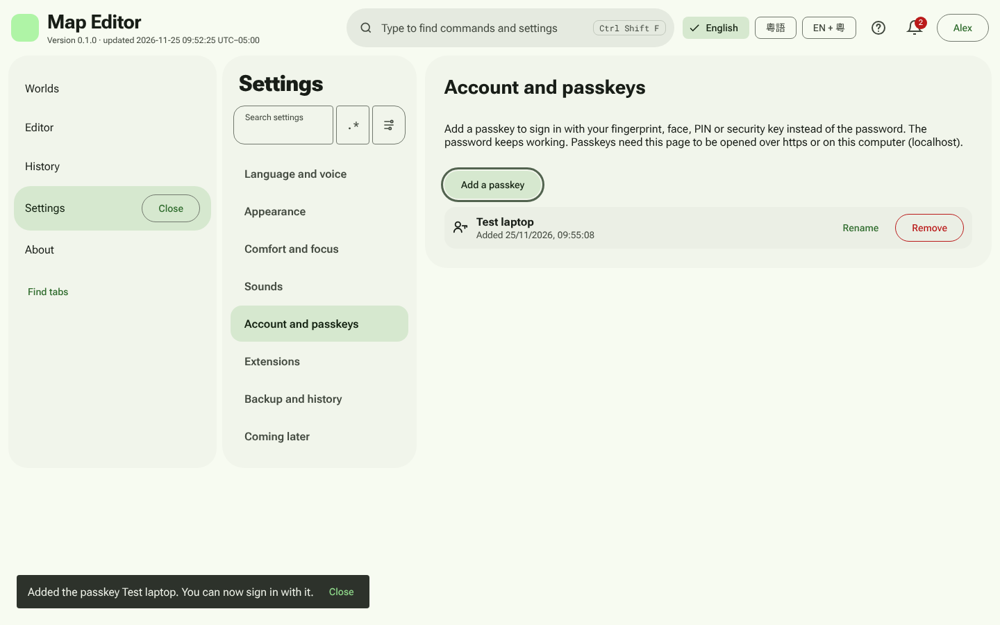

# Docker web app · Docker 網頁程式

> Run Map Editor on one machine and use it from any browser on your network.
>
> 喺一部機度行 Map Editor，然後喺你網絡入面任何一個瀏覽器度用。

Category: [Ways to run it](README.md) · [Read on the website, with pictures](https://ding-ding-projects.github.io/map-editor/web-app/)

## What it does

The web app is the same editor served by a small Node.js server in a Docker container. Your worlds folder is mounted into the container; edits are written straight into those worlds.

網頁程式係同一個編輯器，由 Docker 容器入面一個細細哋嘅 Node.js 伺服器提供。你個世界資料夾會掛載入個容器度；所有編輯都係直接寫入嗰啲世界。

## Start it

Run node scripts/setup.mjs (or host.bat on Windows). It asks for a port and your worlds folder, writes .env, starts docker compose, waits for the health check and prints the link to open. host.bat --detached runs it in the background and host.bat --logs follows the live log.

執行 node scripts/setup.mjs（喺 Windows 就用 host.bat）。佢會問你要邊個連接埠同世界資料夾喺邊，寫好 .env，啟動 docker compose，等健康檢查通過，然後印條連結出嚟畀你開。host.bat --detached 會喺背景行，host.bat --logs 就會跟住即時記錄。

## First visitor becomes the owner

There is no setup code. The first person to open the link and register becomes the owner. Two people registering at the same moment cannot both win: the server decides with one atomic file create, and the second gets a clear message to sign in instead.

唔使設定碼。第一個開條連結兼註冊嘅人就會成為擁有人。兩個人同一刻註冊，唔會兩個都贏：伺服器用一次原子式建立檔案嚟決定，第二個會收到清楚嘅訊息，叫佢改為登入。

## Passkeys

After signing in with the password, Settings › Account and passkeys › Add a passkey lets you sign in with a fingerprint, face, PIN or security key instead. The sign-in screen then shows Sign in with a passkey. Browsers only allow passkeys on https or on the computer itself (localhost), so when you open Map Editor by its plain-http network address the password stays the way in; put it behind https, and set MAP_EDITOR_ORIGIN to that https address if a proxy changes the host name. Passkeys can be renamed and removed, and every add, removal and passkey sign-in is in the activity record.

用密碼登入之後，「設定（Settings）› 帳戶同通行密鑰（Account and passkeys）› 加入通行密鑰（Add a passkey）」可以畀你改用指紋、面容、PIN 或者安全密鑰嚟登入。之後登入畫面就會顯示「用通行密鑰登入（Sign in with a passkey）」。瀏覽器只容許喺 https 或者電腦本身（localhost）用通行密鑰，所以如果你用普通 http 嘅網絡地址開 Map Editor，就仍然要靠密碼入去；將佢放喺 https 後面，如果有代理伺服器改咗主機名，就將 MAP_EDITOR_ORIGIN 設定做嗰個 https 地址。通行密鑰可以改名同移除，而每次加入、移除同用通行密鑰登入，都會記喺活動記錄度。

## Authenticator app

Settings › Account and passkeys › Set up an authenticator app adds a 6-digit code after the password. Open the link on the phone with the app (or type the key), then enter the code it shows to turn it on. From then on, signing in with the password asks for the newest code; each code works once. Turning it off needs a code too. Signing in with a passkey does not ask for a code.

「設定（Settings）› 帳戶同通行密鑰（Account and passkeys）› 設定驗證器程式（Set up an authenticator app）」會喺密碼之後加多一個 6 位數字碼。喺裝咗驗證器程式嘅手機度開條連結（或者自己打條密鑰入去），再輸入佢顯示嘅數字碼就開啟到。由嗰陣開始，用密碼登入就會問你攞最新嘅數字碼；每個碼只用得一次。要關返佢都要一個碼。用通行密鑰登入就唔會問數字碼。

## Security

Every API call needs a signed-in session. The server only opens worlds inside the folders it was started with, refuses cross-site form posts, and sends a strict content security policy.

每個 API 呼叫都要有已登入嘅工作階段。伺服器只會開啟佢啟動嗰陣指定嘅資料夾入面嘅世界，拒絕跨網站嘅表單提交，仲會送出嚴格嘅內容安全政策。

## Related

- [Appliance image](../ways-to-run-it/appliance.md)
- [Map Editor Deploy](../ways-to-run-it/deploy-app.md)
- [Desktop app](../ways-to-run-it/desktop-app.md)

<!-- Generated by scripts/feature-docs.mjs from site/content.mjs. Edit the source, then run the script. -->
